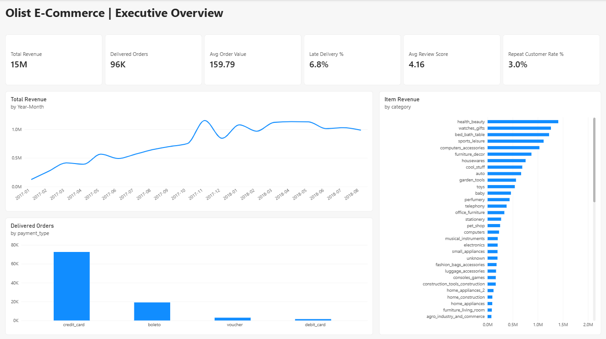

# Olist E-Commerce Sales & Customer Analytics

End-to-end analytics project on **~100K real orders** from Olist, a Brazilian online marketplace: raw CSVs → SQL data model → Power BI dashboard → business recommendations.

**Tools:** Python, DuckDB SQL, Power BI (star schema, DAX)
**Data:** [Brazilian E-Commerce Public Dataset by Olist](https://www.kaggle.com/datasets/olistbr/brazilian-ecommerce) — 9 tables, Sep 2016 – Oct 2018
**Analysis window:** Jan 2017 – Aug 2018 (edge months have too few orders to trust)



---

## Business questions

1. How big is the business, and how fast is it growing?
2. Which product categories drive revenue?
3. Do customers come back?
4. Does delivery performance affect customer satisfaction?
5. Where are the operational problems by region?
6. How concentrated is revenue across sellers?

## Key findings

| # | Finding | Number |
|---|---|---|
| 1 | **Strong growth.** Delivered revenue for Jan–Aug 2018 was up sharply on Jan–Aug 2017. | R$15.4M total revenue, 96K delivered orders, +143% YoY (Jan–Aug) |
| 2 | **Late deliveries wreck reviews.** On-time orders average 4.29 stars; late orders average 2.27, and 62% of late orders get a 1–2 star review. Orders 8+ days late average 1.71. | Late orders are 6.7% of reviewed orders but **33% of all bad reviews** |
| 3 | **Almost nobody comes back.** Only 3.0% of customers ever placed a second order, and fewer than 2.6% of any monthly cohort returned within 6 months. | Repeat customers spend ~2× more (R$309 vs R$161 lifetime) |
| 4 | **Rio and Bahia have a delivery problem.** RJ is the #2 state by revenue (13%), yet 12.2% of its orders arrive late, ~3× São Paulo's 4.5%. Bahia is also at 12.2%. | SP 8.7 days avg delivery vs RJ 15.2, BA 19.3 |
| 5 | **Revenue is concentrated.** The top 10% of sellers (295 of 2,945) generate 66% of revenue. | Top 3 categories (health & beauty, watches & gifts, bed/bath/table) = 25% of revenue |
| 6 | **Black Friday is the single biggest event.** Nov 2017 revenue jumped 54% over October; 24 Nov 2017 alone had 1,176 orders. | Credit card = 75.5% of orders, avg 3.5 installments |

## Recommendations

1. **Fix delivery estimates and carriers in RJ and BA first.** These two states combine high revenue with 3× the late rate. Renegotiating carrier SLAs or pushing estimated delivery dates out by a few days in these regions would directly reduce bad reviews, since a third of all 1–2 star reviews come from late orders.
2. **Launch a second-purchase program.** With a 3% repeat rate and repeat buyers worth 2× as much, even moving the rate to 5% is meaningful. Target: a post-delivery voucher sent only after an *on-time* delivery (when the customer is happiest), timed within 30–90 days.
3. **Protect and grow the top sellers.** 295 sellers drive two-thirds of revenue. A seller-success program (faster payouts, priority logistics) for the top decile reduces concentration risk; onboarding support for mid-tier sellers spreads it out.
4. **Plan Black Friday capacity early.** The November spike is the year's peak demand. Pre-booking carrier capacity for late November prevents the delivery delays that hurt reviews at the moment volume is highest.
5. **Monitor late delivery % as a top KPI.** It is the clearest leading indicator of customer satisfaction in this data and should sit next to revenue on the executive dashboard.

---

## Dashboard pages

| Page | What it shows |
|---|---|
| **Executive Overview** | KPI strip (revenue, orders, AOV, late %, review score, repeat rate), monthly revenue trend, revenue by category, orders by payment method |
| **Customers & Delivery** | Review score by delivery status, late % by state, monthly orders vs late % |
| **Products & Sellers** | Revenue by category and seller state, top sellers |

## Data model

Star schema built in SQL (`sql/01_build_model.sql`) and loaded into Power BI:

```
dim_date ──┐
           ├──< fact_orders >── dim_customers
           │        │
           │        └──< fact_order_items >──┬── dim_products
                                             └── dim_sellers
```

- **Customers are counted by `customer_unique_id`.** Olist issues a new `customer_id` for every order, so counting that column would make every customer look new and hide repeat behavior.
- **Filters reach `fact_order_items` through `fact_orders`**, keeping single-direction relationships and no ambiguous paths. Category and seller visuals use an item-level revenue measure for that reason.
- Revenue = price + freight on **delivered orders only**.

## DAX measures

`Total Revenue`, `Delivered Orders`, `Avg Order Value`, `Customers`, `Revenue Prev Month`, `MoM Growth %`, `Late Delivery %`, `Avg Delivery Days`, `Avg Review Score`, `Bad Review %`, `Cancellation Rate %`, `Repeat Customer Rate %`, `Item Revenue`, plus a calculated `Delivery Status` column bucketing orders by days late.

Example:

```dax
Repeat Customer Rate % =
DIVIDE (
    CALCULATE ( COUNTROWS ( dim_customers ), dim_customers[is_repeat_customer] = 1, dim_customers[total_orders] > 0 ),
    CALCULATE ( COUNTROWS ( dim_customers ), dim_customers[total_orders] > 0 )
)
```

## How to reproduce

```bash
pip install duckdb pandas
# put the 9 Kaggle CSVs in data/raw/
python load_data.py      # loads raw CSVs into olist.duckdb + data-quality report
python run_analysis.py   # builds the star schema, exports data/clean/*.csv, answers Q1–Q10
```

Then open `powerbi/olist_dashboard.pbix` (Power BI Desktop, Windows).

## Repository structure

```
├── data/raw/                 # Kaggle CSVs (not committed)
├── data/clean/               # star-schema tables loaded by Power BI
├── sql/
│   ├── 01_build_model.sql    # cleaning + star schema
│   └── 02_business_questions.sql   # Q1–Q10
├── outputs/                  # query results as CSV
├── powerbi/olist_dashboard.pbix
├── images/                   # dashboard screenshots
├── load_data.py
└── run_analysis.py
```

**Author:** Vishwa Patel · [LinkedIn](https://linkedin.com/in/vishwa-patel1793) · [GitHub](https://github.com/vishwa-patel-1709)
